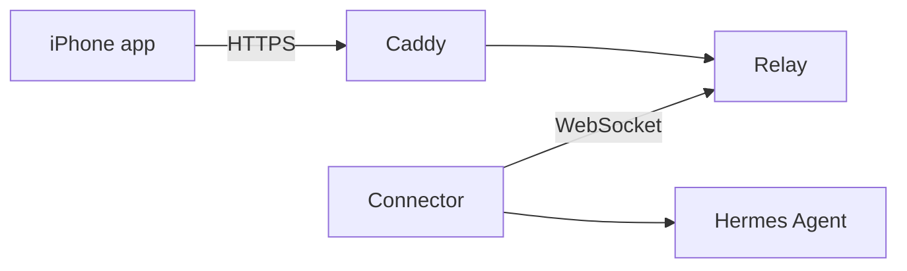

# Hermes iOS

> [!NOTE]
> An independent community project. Not affiliated with or endorsed by [Nous Research](https://nousresearch.com/) or the official [Hermes Agent](https://github.com/NousResearch/hermes-agent). Forked from [dylan-buck/Hermes-iOS](https://github.com/dylan-buck/Hermes-iOS).

A native iPhone app for your own [Hermes Agent](https://github.com/NousResearch/hermes-agent), running on a VM you control. Chat with your agents, browse their history (including Telegram conversations), schedule automations, and manage what Hermes knows, all from your phone.

## What you get

- **Agents**: pick which Hermes agent (profile) to talk to; each keeps its own current conversation and memory. Personas are read-only in the app.
- **Chat and history**: streaming replies, attachments (photos, PDFs, Office files, audio up to 5 MB), slash commands, and earlier Hermes history including Telegram sessions.
- **Voice notes**: record a note and it is transcribed by Hermes's own local speech-to-text.
- **Automations**: view scheduled jobs, run them, pause them and read each run's output.
- **Library**: edit what Hermes remembers about you, and switch installed skills on or off.
- **Phone context and widgets**: location, health and motion are available to selected agents through MCP tools if you allow it, and home-screen widgets show the state.

## How it works



- **Relay** (`relay/`): the only public service, behind Caddy. Pairs your phone, stores chats, and forwards requests to the connector.
- **Connector** (`connector/`): runs next to Hermes on the VM. It runs your chats as the chosen agent and exposes an allowlisted slice of Hermes's dashboard API to the app. Nothing else on the VM is publicly reachable.

## Set up your own

You need a VM already running Hermes Agent, a DNS name pointing at it, and a way to sideload an IPA onto your iPhone (iOS 26+).

1. **Install on the VM** by following [deploy/vm/README.md](deploy/vm/README.md): it covers the firewall and DNS prerequisites, `install.sh`, registering phone context, and rollback with `uninstall.sh`.
2. **Get the app.** Build the unsigned IPA on a Mac with Xcode:
   ```bash
   scripts/build_unsigned_ipa.sh
   ```
   then sideload `HermesMobile-unsigned.ipa` with your usual tool.
3. **Pair your phone.** Create a pairing code on the VM:
   ```bash
   sudo -u hermes hermes-mobile pair-phone
   ```
   In the app, choose *Enter Code Manually*, set the relay URL to `https://<your-dns-name>/v1`, and enter the code.

## Limitations

- Sideloaded builds can't receive push notifications, so the app refreshes while it's open; widgets may not share data after re-signing.
- Everything Hermes reads — including phone data you share — is sent to your model provider.
- Running the relay and connector on your own machine still works; see [connector/README.md](connector/README.md) and [relay/README.md](relay/README.md).

## Development

| Part | Tests |
|---|---|
| Connector (`connector/`) | `pip install -e 'connector[dev]' && pytest` |
| Relay (`relay/`) | `pip install -e 'relay[dev]' && pytest` |
| App | `xcodebuild -project HermesMobile.xcodeproj -scheme HermesMobile -destination 'platform=iOS Simulator,name=iPhone 17 Pro' test` |

- Add new Swift files with `scripts/xcode_add_files.py` (don't regenerate the project with XcodeGen; `project.yml` is out of date).
- The app runs against mock data with `UITEST_PAIRING_MODE=mock`; `ScreenshotTourUITests` captures every screen when `SCREENSHOT_DIR` is set.
- Design and implementation notes: [docs/superpowers/](docs/superpowers/).

## License

MIT — see [LICENSE](LICENSE).
